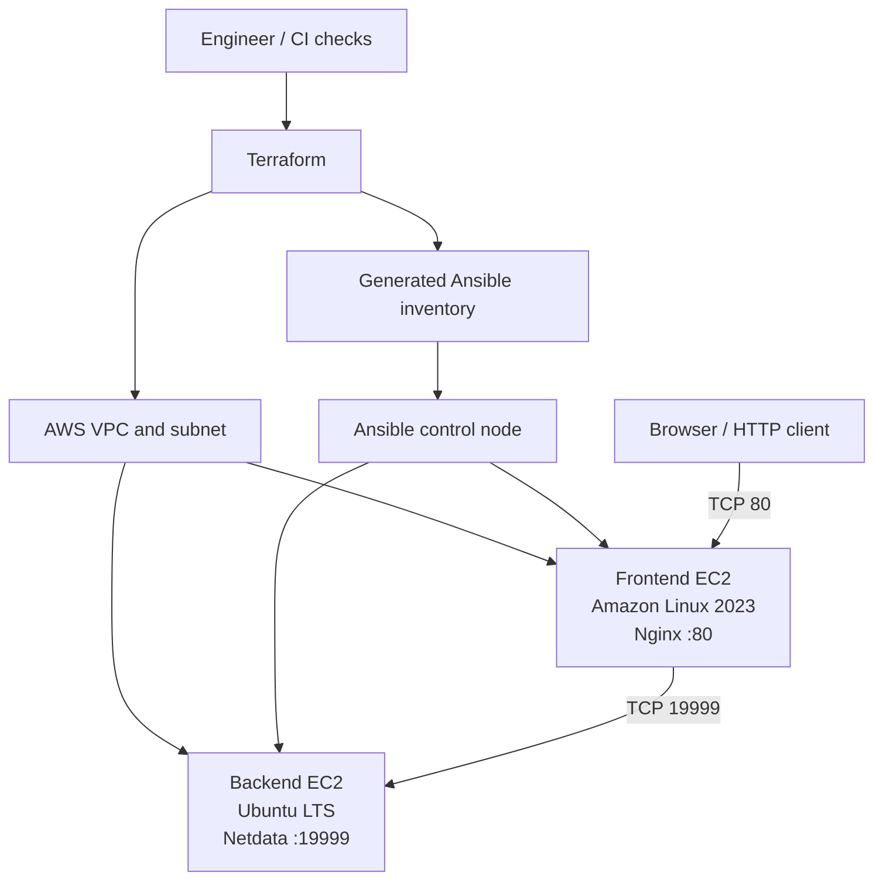

# AWS Infrastructure Automation with Terraform and Ansible

Provision two AWS EC2 instances with Terraform, configure them with Ansible, and publish the Netdata monitoring interface through an Nginx reverse proxy.

> **Project provenance:** This repository is a cleaned-up, security-conscious implementation of the workflow documented in `Challenge-Terraform-Ansible.pdf` (the source project). The source demonstrated Amazon Linux as the frontend, Ubuntu 21.04 as the backend, Nginx, and Netdata. Ubuntu 21.04 is end-of-life, so this implementation defaults to a supported Ubuntu LTS image and documents how to select a different AMI if you have a specific compatibility requirement. The source's Nginx template listened on 19999 despite describing port 80; this repository corrects the listener to port 80.

## Project overview

The project separates infrastructure provisioning from machine configuration:

1. Terraform discovers the default VPC and a subnet, creates dedicated security groups and two EC2 instances, and outputs their addresses.
2. Terraform renders an Ansible inventory from the instance outputs.
3. Ansible applies common OS configuration, installs Nginx on the frontend, and installs Netdata on the backend.
4. Nginx proxies HTTP requests on port 80 to the backend's Netdata service on port 19999.
5. Validation checks confirm Ansible connectivity, service state, and the HTTP endpoint.

## Features

- Reusable Terraform EC2 module and variable-driven configuration.
- Dynamic Ansible inventory generated from Terraform outputs.
- Separate frontend and backend security groups.
- SSH ingress restricted by a configurable administrator CIDR.
- Netdata port 19999 is reachable only from the frontend security group.
- Ansible roles for baseline configuration, Nginx, and Netdata.
- GitHub Actions checks for Terraform formatting/validation and Ansible linting.
- Deployment, validation, teardown, architecture, and security documentation.

## Architecture



The control node can be the engineer's machine or a separately managed EC2 instance with Terraform, Ansible, AWS credentials, and SSH access. Keep the private key on the control node; never commit it.

## Technology stack

| Technology | Purpose |
|---|---|
| AWS EC2 / VPC / Security Groups | Compute and network access control |
| Terraform | Repeatable infrastructure provisioning and outputs |
| Ansible | Idempotent operating-system and application configuration |
| Nginx | Reverse proxy for the Netdata web interface |
| Netdata | Host metrics and monitoring dashboard |
| GitHub Actions | Automated static validation on pull requests |

## Repository layout

```text
.
├── .github/workflows/ci.yml
├── ansible/
│   ├── ansible.cfg
│   ├── group_vars/all.yml
│   ├── inventory/hosts.ini.example
│   ├── playbooks/site.yml
│   └── roles/{common,nginx,netdata}/
├── docs/
│   ├── architecture.md
│   ├── deployment.md
│   ├── security.md
│   └── screenshots/
├── terraform/
│   ├── main.tf
│   ├── variables.tf
│   ├── outputs.tf
│   ├── versions.tf
│   ├── terraform.tfvars.example
│   └── modules/ec2/
├── scripts/validate.sh
├── CHANGELOG.md
├── CONTRIBUTING.md
├── LICENSE
└── README.md
```

## Prerequisites

- An AWS account and permissions to create EC2 instances, security groups, and key pairs.
- Terraform `>= 1.5` and AWS CLI v2.
- Ansible Core `>= 2.15` and `ansible-lint` for local validation.
- An SSH key pair whose public key is supplied to Terraform. Keep the private key readable only by your user.
- A default VPC with at least one subnet in the selected region, or adapt the networking data sources for your VPC.

Configure credentials using an AWS profile, environment-based credentials, or an IAM role. Do not put access keys in Terraform files or commit `terraform.tfvars`.

## Quick start

### 1. Configure Terraform

```bash
cd terraform
cp terraform.tfvars.example terraform.tfvars
# Edit terraform.tfvars: set region, admin_cidr, public_key_path and instance types.
terraform init
terraform fmt -recursive -check
terraform validate
terraform plan
terraform apply
```

The `admin_cidr` value must be your trusted public IP in CIDR notation, for example `203.0.113.10/32`. Do not use `0.0.0.0/0` for SSH.

### 2. Review the generated inventory

Terraform writes `ansible/inventory/hosts.ini`. This file is generated and ignored by Git. Confirm the hosts and SSH usernames before running Ansible:

```bash
cat ../ansible/inventory/hosts.ini
```

The inventory uses public IP addresses for a simple standalone demonstration. For a private production network, use private IPs and run Ansible from a control node inside the VPC, or connect through a managed access path such as AWS Systems Manager Session Manager.

### 3. Configure the machines

```bash
cd ../ansible
ansible-inventory -i inventory/hosts.ini --graph
ansible all -i inventory/hosts.ini -m ping
ansible-playbook -i inventory/hosts.ini playbooks/site.yml
```

If your SSH key is not at the path configured in `terraform.tfvars`, update the generated inventory path or your SSH agent. The `ansible_user` values are `ec2-user` for Amazon Linux and `ubuntu` for Ubuntu.

### 4. Verify

```bash
ansible -i inventory/hosts.ini frontend -b -m command -a 'systemctl is-active nginx'
ansible -i inventory/hosts.ini backend -b -m command -a 'systemctl is-active netdata'
```

Open `http://FRONTEND_PUBLIC_IP/` in a browser. The dashboard should be served through Nginx. The backend security group permits port 19999 only from the frontend security group, not from the public internet.

## Deployment workflow

1. Review variables and security-group rules.
2. Run `terraform fmt`, `terraform validate`, and `terraform plan`.
3. Apply Terraform and inspect outputs.
4. Confirm generated inventory and SSH reachability.
5. Run the Ansible playbook.
6. Validate services and the proxy endpoint.
7. Capture fresh screenshots with any public addresses and account identifiers redacted.
8. Run `terraform destroy` when the environment is no longer needed.

Detailed instructions: [Deployment guide](docs/deployment.md). Architecture: [Architecture notes](docs/architecture.md). Security: [Security notes](docs/security.md).

## Screenshots and evidence

The original PDF includes an AWS instance list, Terraform public-IP outputs, Ansible connectivity and playbook results, and a Netdata dashboard. Selected source evidence is included in [`docs/screenshots/`](docs/screenshots/). These images document the original run; IP addresses, AMI availability, and service versions can change. They are not proof that the updated code has been executed in a new AWS account. See [Evidence notes](docs/screenshots/README.md).

## CI checks

GitHub Actions runs Terraform formatting and validation and Ansible linting. The workflow intentionally does **not** run `terraform apply`; deployments require explicit credentials, review, and approval. Static checks do not replace a live deployment test.

## Security considerations

- SSH is restricted by `admin_cidr`.
- HTTP is public in this demonstration; use TLS and an appropriate access-control strategy before exposing monitoring data publicly.
- Netdata is not directly exposed to the internet.
- The original PDF disables SELinux and host firewalls. This repository does not disable SELinux and does not stop host firewalls by default; AWS security groups remain the primary network boundary in this example. If a lab requirement explicitly requires disabling host firewalls, do so only in an isolated test environment and document the risk.
- Store Terraform state remotely with encryption, versioning, and locking for team use. Local state is not suitable for collaborative production deployments.
- Review image IDs, package repositories, and operating-system support status before deployment.

## Future improvements

- Remote Terraform state with locking and encryption.
- Private subnets, NAT or VPC endpoints, and Systems Manager access instead of public SSH.
- TLS termination, domain name, and certificate automation.
- Pin and test Ansible collections and OS package versions.
- Add integration tests and a post-deployment HTTP health check.
- Add monitoring alerts, retention policies, backups, and cost controls.

## Learning outcomes

- Provisioning cloud infrastructure declaratively with Terraform.
- Connecting Terraform outputs to a dynamically generated Ansible inventory.
- Using Ansible roles and templates for repeatable configuration.
- Separating frontend and backend network access.
- Validating reverse-proxy behavior and monitoring service health.
- Adding static quality checks to a GitHub workflow.

## Resume-ready project summary

See [Career content](docs/career-content.md) for a 150-word description, resume bullets, and LinkedIn copy. Example professional commits are in [Commit history examples](docs/commit-history.md).

## License

Released under the MIT License. See [LICENSE](LICENSE).
